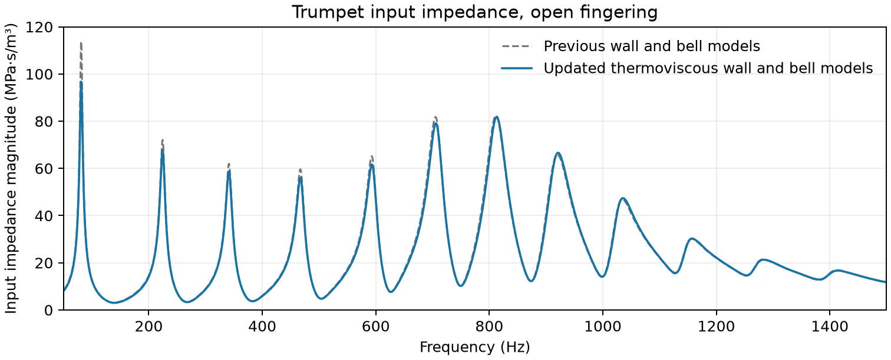

# Brass Instrument Simulator

Physical models for synthesizing trumpet and tenor trombone sounds from the interaction of vibrating lips, a mouthpiece, and an acoustic bore. The project includes CPU models of increasing acoustic complexity and a CUDA solver for nonlinear propagation in an axisymmetric bore.

The current trumpet model combines the two motion coordinates of Adachi and Sato's lip model with cubic stiffness, a distributed mouthpiece, local thermoviscous losses, and a causal bell reflection filter. Pressure waves propagate in both directions, and the returning wave acts on the lips during the simulation.

[Model equations and assumptions](docs/models.md) · [References](docs/references.md) · [Geometry and presets](data/README.md) · [Japanese notes](docs/ja/README.md)

## Audio samples

All samples are ascending B-flat major scales at concert pitch, with A4 = 440 Hz. They are 48 kHz, 16-bit, mono WAV files. Follow a link to open or download a sample.

| Sample | Range | Duration | Model |
| --- | --- | --- | --- |
| [Trumpet, current model](samples/trumpet_Bb3_Bb5_major_f_modern_1p5x.wav) | B♭3–B♭5 | 18.12 s | Axisymmetric Euler, cubic lip stiffness, thermoviscous relaxation, second-order bell reflection |
| [Trombone, stronger attack](samples/trombone_Bb2_Bb4_major_f_strong_attack.wav) | B♭2–B♭4 | 12.08 s | Axisymmetric Euler with a faster, temporarily boosted blowing pressure |
| [Trombone, standard attack](samples/trombone_Bb2_Bb4_major_f_axisymmetric.wav) | B♭2–B♭4 | 12.08 s | Axisymmetric Euler with the original lip and loss models |
| [Trumpet, original axisymmetric model](samples/trumpet_Bb3_Bb5_major_f_axisymmetric.wav) | B♭3–B♭5 | 12.08 s | Axisymmetric Euler with the original lip and loss models |
| [Trumpet, bidirectional waveguide](samples/trumpet_Bb3_Bb5_major_f_bidirectional_nonlinear.wav) | B♭3–B♭5 | 12.08 s | One-dimensional waveguide with nonlinear forward and returning waves |
| [Trumpet, prescribed-wave propagation](samples/trumpet_Bb3_Bb5_major_f_nonlinear.wav) | B♭3–B♭5 | 12.08 s | One-way generalized Burgers propagation |
| [Trumpet, linear bore](samples/trumpet_Bb3_Bb5_major_f.wav) | B♭3–B♭5 | 12.08 s | Two-coordinate lips coupled to a linear transfer-matrix bore |

The current trumpet performance extends each note and gap by a factor of 1.5. The note durations are 1.08 s, with 1.65 s for the final B♭5 and 0.09 s gaps. Attack and release times retain their earlier values. Each note starts from a resting instrument.

Blowing pressures and lip settings are selected for forte playing in each register. Each complete file uses one common output gain. Playback amplitude therefore also depends on the chosen file gain and playback system. [Sample metadata and regeneration commands](samples/README.md)

## Install

Python 3.12 was used for development. NumPy, SciPy, Numba, and Matplotlib are required. Run commands from the repository root.

```sh
git clone https://github.com/KotaroFujisawa/Brass-Instruments-Similartor.git
cd Brass-Instruments-Similartor
python -m venv .venv
```

Activate the environment on Windows PowerShell with `.venv\Scripts\Activate.ps1`, or on Linux with `source .venv/bin/activate`, then install the dependencies.

```sh
python -m pip install -r requirements.txt
```

The CPU models can run with these dependencies. The axisymmetric models also require an NVIDIA GPU, an NVIDIA driver, and NVRTC, the CUDA runtime compiler. The solver uses the CUDA Driver API directly through Python ctypes.

```sh
python -m pip install nvidia-cuda-nvrtc-cu12==12.4.127
```

The CUDA calculations were run on an NVIDIA RTX 2000 Ada Generation with NVRTC 12.4.127. On Windows, the loader searches installed Python packages, `CUDA_NVRTC_DIR`, and `CUDA_PATH/bin`. On Linux, make `libnvrtc.so.12` and its companion libraries available through the system loader or `LD_LIBRARY_PATH`. Linux execution has not been verified in this project.

## Generate the current trumpet scale

```sh
python src/render_trumpet_modern.py
python src/verify_trumpet_modern.py
python src/plot_trumpet_modern.py
```

The audio is written to `output/trumpet_modern/trumpet_Bb3_Bb5_major_f_modern_1p5x.wav`. The same directory holds per-note traces, measurements, verification results, and an input-impedance plot. Cached traces are keyed by model source, geometry, duration, and performance settings.

For a shorter first run, compute one sustained note.

```sh
python src/render_trumpet_modern.py --only Bb4 --probe 0.45
```

This command saves a trace and prints measurements. A full-scale WAV is produced by the command without `--only` or `--probe`.

The saved performance combines `data/performance_axisymmetric.json` with overrides in `data/performance_trumpet_modern.json`. These contain the lip frequency, blowing pressure, equilibrium opening, valve combination, and tuning length for each note.

## Generate the trombone scale

```sh
python src/verify_trombone.py
python src/trombone_axisymmetric.py
python src/verify_trombone.py --coupling
python src/plot_trombone.py
python src/render_trombone_attack.py --preset data/performance_trombone_attack.json
```

The standard performance is written to `output/trombone_axisymmetric/` and the stronger-attack performance to `output/trombone_attack/`. Generate the standard performance first because the attack renderer uses its measurements and traces for comparison.

The trombone uses its own bore, mouthpiece, slide positions, and lip dimensions. Its preset uses the original wall-loss and bell-load approximations. The cubic stiffness and newer thermoviscous closure are enabled in the current trumpet renderer.

## Run a CPU model

For the linear bore coupled to the nonlinear lips, generate the saved performance and its diagnostic plot.

```sh
python src/render_scale.py --render
python src/verify.py
```

For the one-dimensional waveguide, including nonlinear return-wave feedback, run the following.

```sh
python src/render_bidirectional.py
python src/verify_bidirectional.py
python src/verify_bidirectional.py --full
python src/plot_bidirectional.py
```

The prescribed-wave approximation is available through `python src/render_nonlinear.py` and `python src/verify_nonlinear.py --full`. Its lip excitation is calculated with the linear resonator and then propagated through the nonlinear model. The bidirectional and axisymmetric renderers calculate the returning wave within their evolving acoustic state.

## Models and geometry

The trumpet bore is digitized from the York B-flat trumpet in Figure 7.52 of Campbell, Gilbert, and Myers, *The Science of Brass Instruments*. The trombone uses the Conn 8H profile in Figure 4.22. A mouthpiece cup, throat, and backbore are included for each instrument. Some mouthpiece dimensions are inferred and calibrated to published volume or resonance data.

The CUDA solver evolves density, axial and radial momentum, and total energy using annular finite volumes, MUSCL reconstruction, an HLLC flux with HLLE fallback, and two-stage SSP Runge–Kutta integration. This conservative formulation can capture shock waves. Lip flow and cup pressure are coupled through the instantaneous returning acoustic characteristic.

The current trumpet adds a positive cubic restoring term to the transverse lip motion. The coefficient is a modeling choice informed by artificial-lip research. Local circular-duct Bessel responses are approximated with positive relaxation modes for viscous and thermal losses. The bell uses Silva and colleagues' causal second-order approximation for an unflanged circular opening.

The emitted sound is estimated from the time derivative of the bell volume flow using a compact monopole at 1 m. Bore bends are unfolded into an axisymmetric profile. Wall vibration, resolved turbulent jets, the player's vocal tract, an exterior radiation grid, and room acoustics would require additional modeling. Geometry digitization and fitted performance settings limit comparisons with a particular physical instrument. [Equations, provenance, and validation scope](docs/models.md)

## Numerical checks

The shared Euler solver includes a Sod shock-tube check, conservation checks, and a cylindrical radial-mode check.

```sh
python src/verify_axisymmetric.py
```

The current trumpet verification also checks the bell reflection magnitude, thermoviscous fit errors, weak-pulse input impedance, and the effect of disabling return-wave coupling. Published measurements for the included samples are in [docs/results](docs/results).

For the current trumpet sample, the largest late-sustain pitch error is about 8.2 cents. D4, E♭4, and F4 have cycle-to-cycle variation. At B♭4, disabling the return-wave coupling removes sustained oscillation in the tested configuration.



This plot compares two numerical models on the same geometry and mesh. The resonance locations and peak heights can also be affected by the mesh, the digitized profile, and the mouthpiece reconstruction.

## Repository layout

```text
src/             Simulation, rendering, verification, and plotting code
data/            Bore profiles, mouthpiece data, performance presets, source records
samples/         Selected WAV files and their regeneration instructions
docs/models.md   Model equations, assumptions, and validation scope
docs/references.md
                 Books, papers, and the role of each reference
docs/results/    Saved measurements and verification reports
docs/figures/    Selected diagnostic plots
docs/ja/         Original model notes in Japanese
output/          Generated audio, traces, and diagnostics, created locally
tmp/             Local caches and working files, created locally
```

## References

The main sources are Campbell, Gilbert, and Myers (2021) for instrument acoustics and geometry, Adachi and Sato (1996) for two-coordinate lip motion, and more recent work on artificial lips and thermoviscous bore modeling. The current implementation combines these ingredients with the assumptions described above. Full citations, links, figure numbers, and how each source is used are collected in [docs/references.md](docs/references.md).
